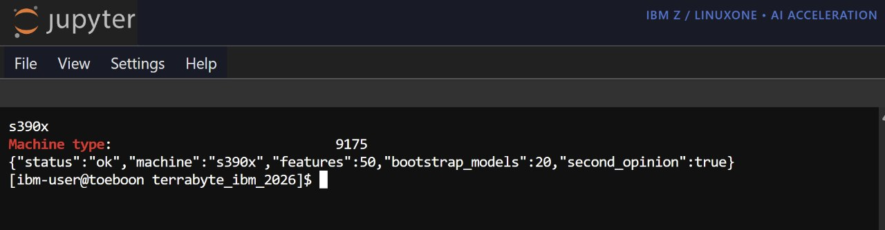
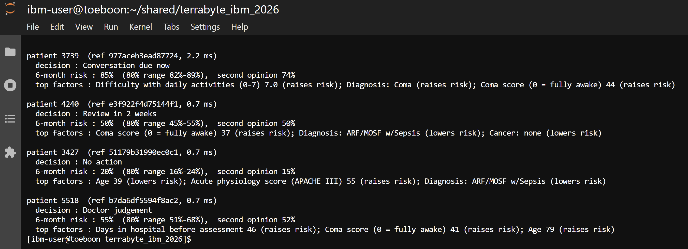
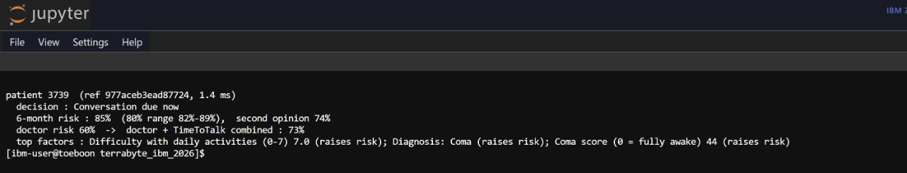
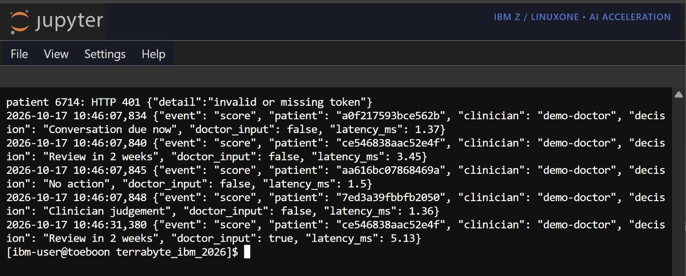
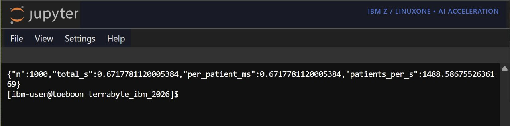
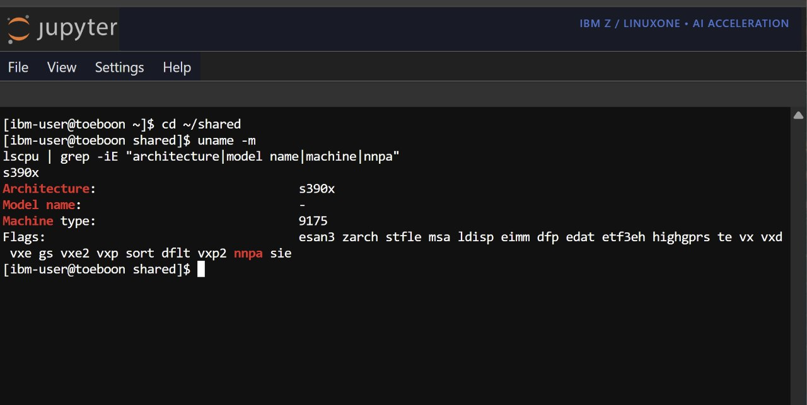
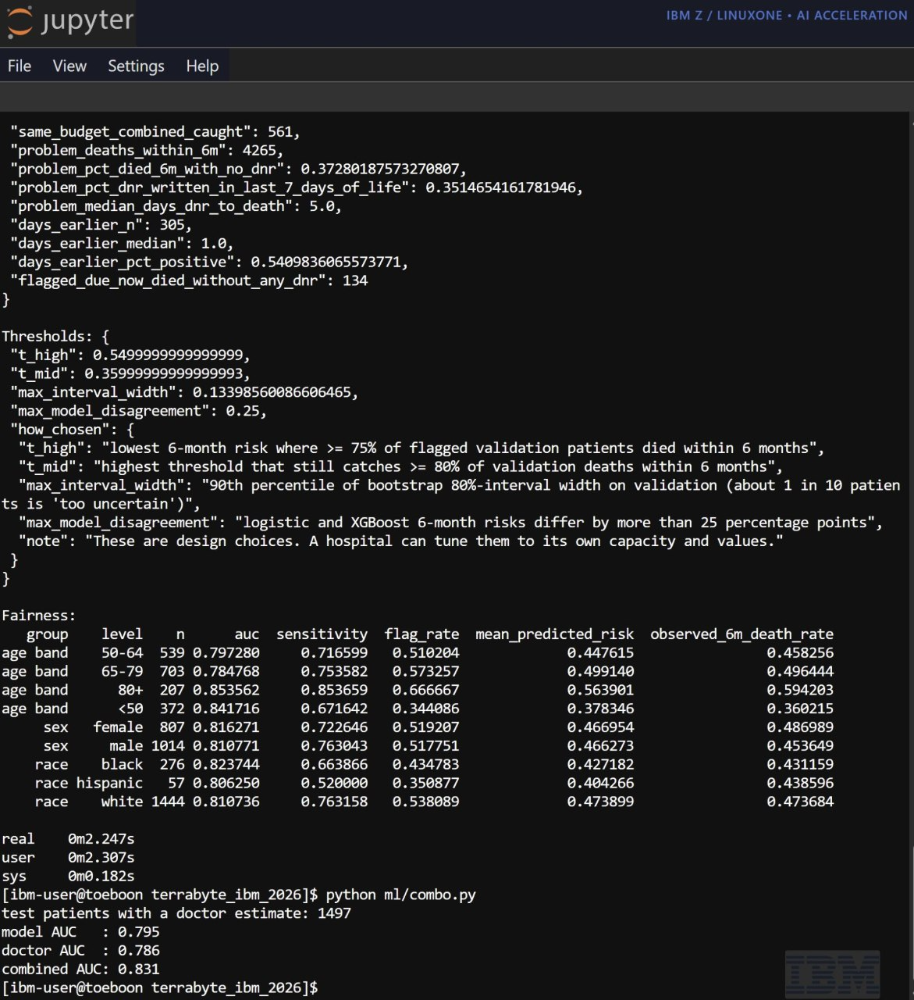
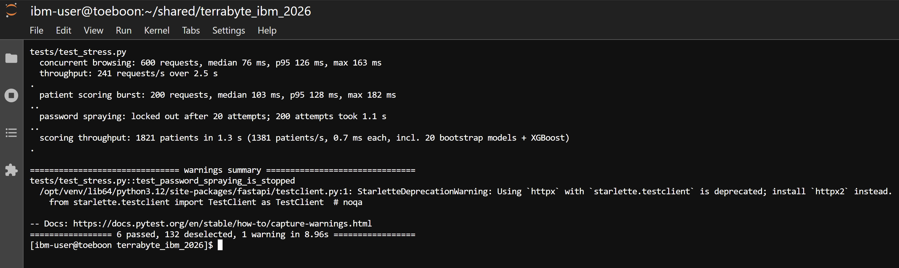
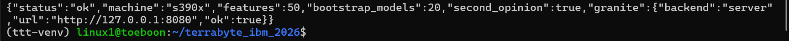
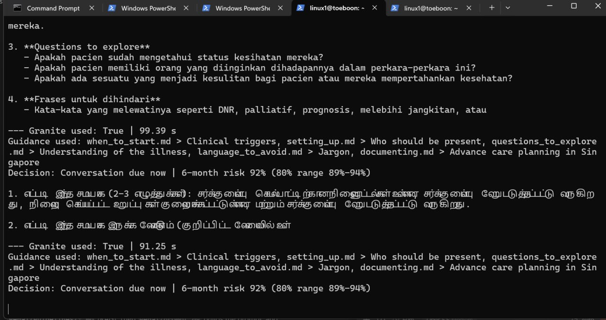

# TimeToTalk — terrabyters_IBM Z Datathon 2026 Project

**AI that tells clinicians when a seriously ill patient is ready for the care-planning conversation, how sure it is, and how to begin.**
Everything, including the LLM, runs inside one isolated IBM LinuxONE (z17) server, so patient data never leaves it.

Event code: SSF2026

## Theme and why IBM Z

**Theme: Wildcard (Beyond the Obvious).** Why LinuxONE:
- **Patient data stays on one isolated server.** Training, scoring, the API and the dashboard all run on the same LinuxONE VM.
- **The LLM runs locally.** IBM Granite runs on the VM through llama.cpp, with no external API.
- **The AI accelerator (NNPA) is available** on the z17 (`nnpa` CPU flag, screenshot 06).
- **Scoring is fast:** about 1,490 patients per second on the z17 (screenshot 05).

## Architecture

```
SUPPORT2 data ─► ml/train.py ─► artifacts/ (JSON models, thresholds, charts)
                                     │
                     ┌───────────────┴──────────────┐
                     ▼                              ▼
         api/ (FastAPI in Podman on LinuxONE)   ml/accelerator_tf.py (main model on the z17 AI accelerator: TensorFlow + IBM zDNN)
          ├ logistic 6-month risk model + 20 bootstrap models (uncertainty)
          ├ Cox model for the survival-curve shape
          ├ XGBoost second opinion
          ├ decision layer: Due now / Review in 2 weeks / No action / Doctor judgement
          └ token auth, hashed patient IDs, audit log, non-root container
                     │
                     ▼
         genai/ IBM Granite (llama.cpp, local) + RAG over care-planning guidelines
                     │  → conversation prep sheet (EN / 中文 / Melayu) + "ask the guidelines" coach
                     ▼
         app/ clinician dashboard (FastAPI + server-rendered HTML: login, roles, worklist, audit log)
```

**Model files:** `artifacts/` is what `ml/train.py` writes on each run. `artifacts_logistic/` is a frozen copy of the same logistic-model run that the dashboard, its container and the tests read, so a retrain never changes the demo underneath us.

## Run it

Full step-by-step guide, with checks and troubleshooting: **[docs/SETUP.md](docs/SETUP.md)**. Quick version, on the LinuxONE VM:

```bash
# 1. data: download https://hbiostat.org/data/repo/support2csv.zip, unzip it, save the support2.csv inside as data/support2.csv
# 2. train + evaluate (≈1 min on 3 vCPUs). artifacts/bootstraps/ is not in git: on a fresh clone run this
#    (with --bootstraps 20) before building the container, otherwise the uncertainty ranges are missing
python ml/train.py --data data/support2.csv --out artifacts --bootstraps 20
# 3. optional: run the main model on the z17 AI accelerator (NNPA) and benchmark it against plain NumPy
python ml/accelerator_tf.py
# 4. API in a container (Containerfile.ubuntu: python:3.11-slim has no s390x numpy wheel, so we use Ubuntu's s390x packages)
podman build -t timetotalk-api -f api/Containerfile.ubuntu .
podman run -d --name ttt --network host -e TTT_API_TOKEN=$(openssl rand -hex 24) -e TTT_ID_SALT=$(openssl rand -hex 16) timetotalk-api
curl localhost:8000/health
```

## Scoring API (runs on LinuxONE)

A FastAPI service (`api/app.py`) serves the model on the z17. It scores one patient in **about 1–2 ms**.

| Endpoint | What it returns |
|---|---|
| `GET /health` | Status, machine type (`s390x` on LinuxONE), number of loaded models, Granite up/down |
| `POST /score` | Decision, 6-month risk with 80% range, second opinion, top factors in plain English, survival curve. If `doctor_survival_6m` is sent, also the **combined doctor + model risk** |
| `POST /prep_sheet` | Score + Granite conversation prep sheet (`language`: English / Chinese / Malay) |
| `POST /ask_why` | "Ask the guidelines" coach: answers a doctor's communication question from the guideline notes |
| `POST /benchmark?n=1000` | Scores one patient *n* times and reports patients per second |

**Example request**

```json
POST /score   (header: Authorization: Bearer <token>)
{ "patient_id": "3739", "patient": { "age": 80.1, "sex": "male", "dzgroup": "Coma", "scoma": 44, "...": "..." },
  "doctor_survival_6m": 0.4 }
```

**Example reply** (shortened)

```json
{ "decision": "Conversation due now", "risk_6m": 0.85, "risk_6m_interval_80": [0.82, 0.89],
  "combined_risk_6m": 0.72,
  "top_factors": [ { "label": "Difficulty with daily activities (0-7) 7.0", "effect": "raises risk" },
                   { "label": "Diagnosis: Coma", "effect": "raises risk" } ] }
```

**Security**
- **Token required:** every scoring call needs the bearer token. A missing or wrong token gets `401`.
- **Pseudonymised IDs:** patient IDs are SHA-256 hashed with a secret salt before logging. Raw IDs are never stored.
- **Audit log:** every decision is logged with time, doctor and decision. No clinical values are logged.
- **No outside AI:** inference (risk models and Granite) stays on the LinuxONE server.
- **Container:** the container runs as a non-root user (`api/Containerfile.ubuntu`).

The clinician dashboard (`app/`) adds its own login, roles, CSRF protection and audit log: see [app/SECURITY.md](app/SECURITY.md).

**Try it**
- `python api/try_api.py --token <token>` scores 4 demo patients, one per decision.

## Proof it runs on IBM Z (LinuxONE z17)

All screenshots are from our LinuxONE VM (`toeboon`).

**01 — s390x on z17.** `uname -m` and `lscpu` show s390x, machine type 9175 (IBM z17); the API's `/health` on that machine reports 20 bootstrap models and the XGBoost second opinion loaded.


**02 — Four patients, one per decision tier.** Test patients scored through the API: Conversation due now, Review in 2 weeks, No action and Doctor judgement, each with its 80% range, second opinion and top factors, in 0.7–2.2 ms.


**03 — Doctor + AI.** The same patient with the doctor's estimate added: model 85%, doctor 60%, combined 73%.


**04 — Security.** A request with a wrong token gets HTTP 401; the audit log records each score with a hashed patient ID, decision and latency, and no clinical values.


**05 — Speed.** The API benchmark scores 1,000 patients in 0.67 s: about 1,490 patients per second, 0.67 ms each.


**06 — AI accelerator.** `lscpu` lists the `nnpa` flag (the z17's on-chip AI accelerator) on s390x, machine type 9175.


**07 — Training on z17.** The full training run (thresholds, fairness audit) takes 2.2 s; `ml/combo.py` on the 1,497 patients with a doctor estimate gives doctor AUC 0.786, model 0.795, combined 0.831.


**08 — Stress test.** 600 concurrent dashboard requests (median 76 ms, p95 126 ms); password spraying locked out after 20 attempts; all 1,821 test patients scored in 1.3 s (1,381 patients/s, including 20 bootstrap models + XGBoost). 6 tests passed.


**API health on s390x.** The API's `/health` reports machine s390x, 20 bootstrap models, second opinion loaded and Granite connected (`"ok": true`).


**Granite prep sheet on LinuxONE.** Granite generates prep sheets on the VM (`Granite used: True`, 91–99 s each) in Malay and Tamil. The Tamil output is garbled, which is why Tamil was removed.


## Decisions log (what we chose, what we rejected, and why)

| Decision | Why |
|---|---|
| **Logistic regression** for 6-month risk as the main model | SUPPORT2 follows every patient to death or past 6 months, so a model aimed directly at "died within 6 months" loses nothing to censoring. Every factor is explainable, so a clinician can check it, and prediction needs only NumPy, so it runs anywhere on s390x. The Cox model scored about the same on the test set (AUC 0.804 vs 0.813, a gap within noise), so the choice rests on the direct 6-month target and explainability, not that gap. |
| Cox model kept only for the **survival-curve shape** | The dashboard shows a curve over a year. The Cox curve is rescaled to pass through the logistic 6-month risk, so the two never disagree. |
| Wrote our own numpy/scipy Cox model instead of `lifelines` | `lifelines` needs `autograd-gamma`, which failed to build in testing. Ours has no compiled dependencies, so it runs on s390x. |
| All models saved as plain JSON | No pickle files in the API (a pickle can run code when loaded), and the container needs only numpy. |
| **Rejected** deep learning as the main model | Little gain on about 9,000 patients and much harder to explain. A 2-layer net we tried scored lower (AUC 0.72 vs 0.81). |
| Main model also runs on the z17 **AI accelerator** (`ml/accelerator_tf.py`) | A logistic regression is a one-layer neural network, so we load its weights into TensorFlow, and IBM's `ibm-zdnn-plugin` runs it on the NNPA with the same accuracy (AUC 0.813, 0.2 ms per patient). **Honest result:** for a model this small, handing work to the accelerator costs more than it saves, so plain CPU is faster. A larger 2-layer network ran **4.9x faster** on the NNPA than on the CPU. The API keeps the CPU path; the accelerator path is ready for deeper models. |
| **Leaky columns excluded** (death, d.time, hospdead, prg2m/6m, dnr/dnrday, surv2m/6m, slos, costs, avtisst, sfdm2) | The test for each column: would a doctor know it on day 3? If not, it's out. |
| **Race, income and education are not model inputs** | Fairness. They are used only to audit performance across groups (`fairness.csv`). |
| Missing labs → SUPPORT investigators' "normal" values, others → training median, plus a "was missing" flag | A missing lab usually means the doctor didn't think it was needed. This is documented and reproducible. |
| 60/20/20 split stratified on 6-month status, seed 42; thresholds and recalibration use **validation only** | The test set is touched once, at the end. |
| Recalibration (Platt scaling) only kept if it **clearly** helps on a held-out half of validation (error down ≥ 20% and ≥ 0.005) | An earlier isotonic version passed a weaker check on validation but made test calibration worse. |
| **AI + clinician experiment**: combine model risk with the doctor's own estimate (`prg6m`), weights fit on validation | Tests whether the tool adds to clinical judgement rather than replacing it. The doctor estimate is never a model input otherwise. |
| **"Doctor judgement"** output when the uncertainty is wide or the two models disagree | The model should say when it doesn't know. |
| **Rejected** a "risk is rising fast" alert | SUPPORT2 has one snapshot per patient, so we can't validate trends. It's listed under next steps. |
| Granite runs locally, not a cloud LLM | Patient data never leaves LinuxONE. Granite only explains the model's decision and never changes the numbers. |

## Results

All numbers are on **1,821 held-out test patients** the model never saw during training. They're reproduced on the IBM z17 (LinuxONE), where the full training run takes about 2 seconds. Full output is in `artifacts/metrics.json`, `artifacts/fairness.csv` and the `fig_*.png` charts.

### The problem, in the data
Of **4,265** seriously ill patients who died within 6 months:
- **37%** never had a do-not-resuscitate (DNR) decision recorded
- **35%** had it recorded only in their **final 7 days** of life
- the median gap between the DNR decision and death was **5 days**

So **72%** of these patients either never had the decision recorded or had it only in their last week. A DNR order is our stand-in for a care-planning conversation, not the same thing.

### Model performance

| Measure | Result | In plain words |
|---|---|---|
| AUC, death within 6 months | **0.813** | 81% of the time, it ranks a patient who died above one who survived |
| C-index (over time) | 0.736 | Ranking quality across the whole follow-up |
| Calibration error | **2.4 percentage points** | When it says 60% risk, the real rate is close to 60% |
| XGBoost second opinion, AUC | 0.813 | An independent model agrees |

### Decision tiers: share who actually died within 6 months

| Recommendation | Patients | Died within 6 months |
|---|---|---|
| Conversation due now | 571 | **80%** |
| Doctor judgement (model unsure) | 141 (8%) | 50% |
| Review in 2 weeks | 371 | 47% |
| No action | 738 | **20%** |

"Due now", "review" and "doctor judgement" together reach **83%** of patients who died within 6 months.

### AI + clinician: better together
Tested on the 1,497 test patients whose doctor gave a survival estimate:

| | AUC | Deaths caught when each flags the same 763 patients |
|---|---|---|
| Doctor's estimate alone | 0.786 | 524 of 710 |
| TimeToTalk alone | 0.804 | 538 of 710 |
| **Doctor + TimeToTalk** | **0.833** | **560 of 710** |

TimeToTalk matches experienced doctors from routine day-3 data, and **combining the two beats either alone**. With the same workload, the combination catches **36 more** of the patients who died than doctors alone. The two make different mistakes, so the tool sharpens clinical judgement rather than replacing it. (The combination weights are fit on validation data. A simple 50/50 average gives 0.831, from `ml/combo.py`.)

### Fairness audit (test set)

| Group | AUC | Share of deaths flagged |
|---|---|---|
| Age <50 / 50–64 / 65–79 / 80+ | 0.84 / 0.80 / 0.78 / 0.85 | 66% / 71% / 76% / 85% |
| Female / male | 0.82 / 0.81 | 72% / 77% |
| Black / Hispanic / white | 0.82 / 0.81 / 0.81 | 66% / 52%* / 76% |

Ranking accuracy is similar across groups, and predicted risk matches observed risk within each group. The model **flags a smaller share of deaths among younger patients and Black and Hispanic patients**. (*There are only 57 Hispanic test patients, so that figure is unreliable.) A hospital would need to monitor this before using the tool. It's listed under next steps.

### What did *not* hold up (reported honestly)
- **"Doctors are too optimistic":** not true in this data. Doctors' average 6-month survival estimate (50%) was close to reality (53%).
- **"Flags patients days earlier":** compared with when the DNR was written, the median is only 1 day earlier, so we don't claim it.

## Limitations & next steps
- SUPPORT2 is 1989–94 US data. This is a proof of concept. Next step: retrain and validate on Singapore hospital records.
- Repeated measurements per patient → a real "risk is rising" trigger
- Close the fairness gap in how many deaths are flagged for younger and minority patients, e.g. group-aware thresholds, checked on local data
- Clinical pilot with the palliative care team, and link with Singapore's national advance care planning programme
- **Tamil:** removed. Granite 3.3 does not support Tamil and its output was garbled. Next step: a human-verified
  phrasebook (opening line, key questions) in Tamil and Malay, or a dedicated translation model
- Fine-tune Granite on local care-planning guidance in the four official languages

## Ethics
Clinician-facing only. The model prompts and never decides. It is never shown to patients. Thresholds can be adjusted by each hospital.

## Open-source libraries & data
- SUPPORT2 dataset — https://archive.ics.uci.edu/dataset/880
- NumPy — https://numpy.org · SciPy — https://scipy.org · pandas — https://pandas.pydata.org
- scikit-learn — https://scikit-learn.org · XGBoost — https://xgboost.ai · matplotlib — https://matplotlib.org · joblib — https://joblib.readthedocs.io
- TensorFlow — https://www.tensorflow.org · IBM zDNN plugin for TensorFlow (`ibm-zdnn-plugin`, preinstalled in the LinuxONE Jupyter Lab ML image) — https://github.com/IBM/zDNN
- FastAPI — https://fastapi.tiangolo.com · Uvicorn — https://www.uvicorn.org · Pydantic — https://docs.pydantic.dev · Jinja2 — https://jinja.palletsprojects.com · python-multipart — https://github.com/Kludex/python-multipart
- llama.cpp — https://github.com/ggml-org/llama.cpp · IBM Granite 3.3 2B Instruct (GGUF) — https://huggingface.co/ibm-granite/granite-3.3-2b-instruct-GGUF · Hugging Face Hub CLI — https://github.com/huggingface/huggingface_hub
- Podman — https://podman.io · Ubuntu 24.04 container image — https://hub.docker.com/_/ubuntu
- pytest — https://pytest.org · HTTPX — https://www.python-httpx.org
- IBM LinuxONE Community Cloud Jupyter Lab ML image — https://github.com/linuxone-community-cloud/jupyter-lab-ml

Care-planning guidance used for retrieval (`genai/guidelines/`, summarised in our own words, not copied):
- Serious Illness Conversation Guide, Ariadne Labs — https://www.ariadnelabs.org/serious-illness-care/
- VitalTalk — https://www.vitaltalk.org · SPICT — https://www.spict.org.uk
- SPIKES protocol, Baile et al., The Oncologist 2000 — https://doi.org/10.1634/theoncologist.5-4-302
- NICE NG142 End of life care for adults — https://www.nice.org.uk/guidance/ng142
- Living Matters, Agency for Integrated Care Singapore — https://www.livingmatters.sg
